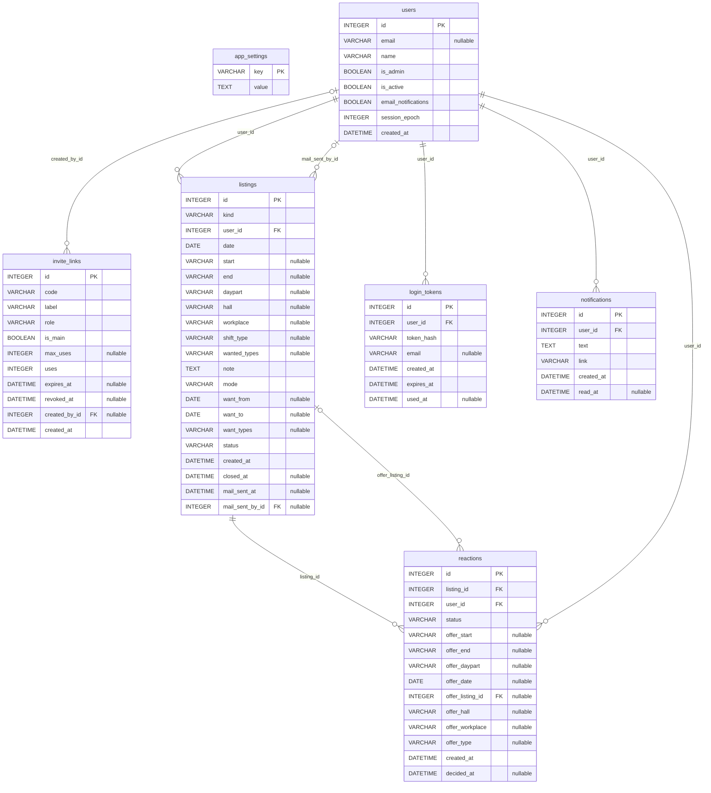

# Entity relationship diagram

GENERATED by `python -m scripts.dump_schema` from `app/models.py`; don't edit by hand. GitHub
renders the diagram below. Paste the code block into https://mermaid.live to edit it or export
an image. Columns marked "nullable" may be empty; `app_settings` has no relations. What every
column means: [database.md](database.md). The exact SQL: [schema.sql](schema.sql).

